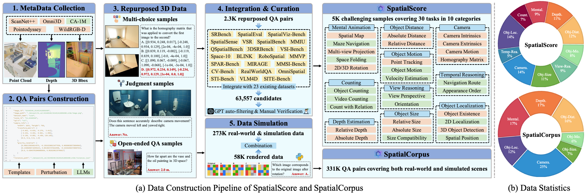
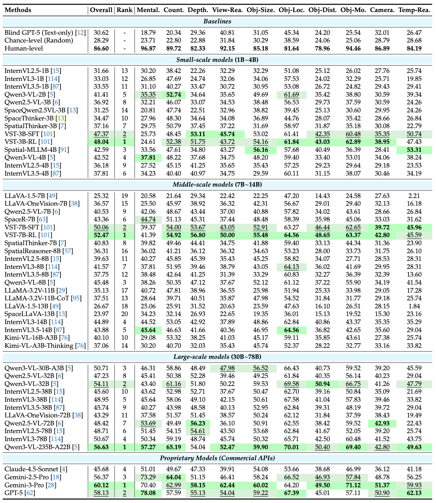

# SpatialScore: Towards Unified Evaluation for Multimodal Spatial Understanding (CVPR 2026 Highlight)
This repository contains the official PyTorch implementation of SpatialScore: https://arxiv.org/abs/2505.17012/.

Our new version paper has been accepted by CVPR 2026, and we have updated our up-to-date code and data!
Feel free to reach out for discussions!

<div align="center">
   
</div>

Current Leaderboard (You are welcome to test your models on SpatialScore!):

<div align="center">
   
</div>

## Some Information
[Project Page](https://haoningwu3639.github.io/SpatialScore/) $\cdot$ [Paper](https://arxiv.org/abs/2505.17012/) $\cdot$ [SpatialScore_Benchmark](https://huggingface.co/datasets/haoningwu/SpatialScore) $\cdot$ [SpatialCorpus](https://huggingface.co/datasets/haoningwu/SpatialCorpus) $\cdot$ [Model](https://huggingface.co/haoningwu/SpatialScore)

## News
- [2026.5] We have updated our up-to-date code and data!
- [2026.4] Glad to share that **SpatialScore** has been accepted to **CVPR 2026** and selected as **Highlight**.
- [2025.5] ~~We have released version_0 of our evaluation code, supporting most mainstream models.~~
- [2025.5] ~~We have released version_0 of SpatialScore, which is available on [Huggingface](https://huggingface.co/datasets/haoningwu/SpatialScore).~~
- [2025.5] Our pre-print paper is released on arXiv.

## Requirements
- Python >= 3.10 (Recommend to use [Anaconda](https://www.anaconda.com/download/#linux) or [Miniconda](https://docs.conda.io/en/latest/miniconda.html))
- [PyTorch >= 2.8.0](https://pytorch.org/)
- accelerate == 1.13.0
- xformers==0.0.32.post1
- flash-attn==2.8.2
- vllm == 0.11.0
- triton == 3.4.0
- triton_kernels (please refer to [gpt_oss](https://wheels.vllm.ai/gpt-oss/triton-kernels/) for version supporting gpt_oss)
- transformers == 4.57.3

The aforementioned dependencies are necessary for conducting evaluations on SpatialScore. 
If you intend to utilize SpatialAgent; since it requires invoking various spatial perception tools, you may need to consult the following repositories to install the corresponding tool dependencies, and download their corresponding pre-trained checkpoints, including [Rex-Omni](https://github.com/IDEA-Research/Rex-Omni), [Map-Anything](https://github.com/facebookresearch/map-anything), [GroundingDINO](https://github.com/IDEA-Research/GroundingDINO) and [DetAny3D](https://github.com/OpenDriveLab/DetAny3D).

A suitable [conda](https://conda.io/) environment named `SpatialScore` can be created and activated with:

```
conda env create -f environment.yaml
conda activate SpatialScore
```

## Dataset
Please check out [SpaitalScore](https://huggingface.co/datasets/haoningwu/SpatialScore) to download our proposed benchmark (`SpatialScore`).

If you cannot access Huggingface, you can use [hf-mirror](https://hf-mirror.com/) to download models.

```
export HF_ENDPOINT=https://hf-mirror.com # Add this before huggingface-cli download
```

You can follow the commands below to prepare the data:

```
huggingface-cli download --resume-download --repo-type dataset haoningwu/SpatialScore --local-dir ./ --local-dir-use-symlinks False
unzip SpatialScore_benchmark.zip
```

## SFT with SpatialCorpus
Please check out [SpaitalCorpus](https://huggingface.co/datasets/haoningwu/SpatialCorpus) to download our introduced training resources (`SpatialCorpus`).

You can follow the commands below to prepare the data:

```
huggingface-cli download --resume-download --repo-type dataset haoningwu/SpatialCorpus --local-dir ./ --local-dir-use-symlinks False
unzip SpatialCorpus.zip
```

Our codebase integrates the training script for Qwen3-VL. 
Once you have prepared the dataset and configured the corresponding data paths, you can use the following script to conduct SFT on the Qwen3-VL model using SpatialCorpus:

```
cd Qwen3-VL/qwen-vl-finetune
bash ./scripts/sft_qwen3_8b.sh
```

For further details, please refer to the official [Qwen3-VL](https://github.com/qwenlm/qwen3-vl) tutorial.


## Evaluation
Considering the current mainstream model architectures, we have prioritized support for the Qwen2.5-VL and Qwen3-VL series models. 
You can evaluate them on SpatialScore using the following commands:

```
CUDA_VISIBLE_DEVICES=0,1 python test_qwen.py --model_name qwen3vl-4b --model_path ./huggingface/Qwen3-VL-4B-Instruct --dataset_json_path ./SpatialScore_benchmark/SpatialScore_benchmark.ndjson --output_dir ./eval_results
```

Now, the All-in-one script supporting all other models is also available.
You can evaluate other models on SpatialScore using the following commands:

```
CUDA_VISIBLE_DEVICES=0,1 python test_all_in_one.py --model_name llava-ov-7b --model_path ../huggingface/LLaVA-OneVision-7B --dataset_json_path ./SpatialScore_benchmark/SpatialScore_benchmark.ndjson --output_dir ./eval_results
```

Our final evaluation encompassed rule-based evaluation and LLM-based answer extraction, which are combined to calculate the final accuracy. 
Therefore, you need to configure [GPT-OSS](https://github.com/openai/gpt-oss) and download the corresponding [GPT-OSS-20B](https://huggingface.co/openai/gpt-oss-20b) checkpoint before running the following script to compute the final score:

```
MKL_THREADING_LAYER=GNU CUDA_VISIBLE_DEVICES=0 python ./evaluate_results.py --input ./eval_results/qwen3vl-4b
```

## Inference with SpatialAgent
Before using SpatialAgent, you need to install the additional dependencies required by the toolbox according to the Requirements section. 

In addition, you should download the checkpoints for the spatial perception tools being used and place them in the `./SpatialAgent/checkpoints/` directory, which should have a structure similar to the following:

```
./SpatialAgent/checkpoints
├── dinov2-large
├── Orient-Anything
│   ├── base100p
│   ├── base100p2
│   ├── base25p
│   ├── base50p
│   ├── base75p
│   ├── base75p2
│   ├── celarge
│   ├── cropbaseEx03
│   ├── croplargeEX03
│   ├── croplargeEX2
│   ├── cropsmallEx03
│   ├── mixreallarge
│   └── ronormsigma1
└── RAFT

./SpatialAgent/DepthAnythingV2
└── ckpt
│   ├── hypersim.pth
│   └── vkitti.pth

./SpatialAgent/DetAny3D
├── GroundingDINO
│   └── weights
│       └── groundingdino_swinb_cogcoor.pth
├── checkpoints/detany3d 
│   ├── detany3d_ckpts
│   ├── dino_ckpts
│   ├── sam_ckpts
│   └── unidepth_ckpts
└── models--bert-base-uncased
```

Furthermore, for [DetAny3D](https://github.com/OpenDriveLab/DetAny3D) and [DepthAnythingV2](https://github.com/DepthAnything/Depth-Anything-V2), you will also need to refer to their respective repositories, download the required checkpoints, and place them in their corresponding directories.

Our SpatialAgent supports two reasoning paradigms: Plan-Execute and ReAct. You can perform inference using the following script:

```
# Plan-Execute paradigm
CUDA_VISIBLE_DEVICES=0  python inference_plan-execute.py --start 0 --end 1000 --prompt_format cota --model_path ../huggingface/Qwen3-VL-4B-Instruct --model_name qwen3vl-4b

# ReAct paradigm
CUDA_VISIBLE_DEVICES=0  python inference_ReAct.py --start 0 --end 1000 --execute --prompt_format cota --model_path ../huggingface/Qwen3-VL-4B-Instruct --model_name qwen3vl-4b
```

## Citation
If you use this code and data for your research or project, please cite:

	@inproceedings{wu2026spatialscore,
      author    = {Wu, Haoning and Huang, Xiao and Chen, Yaohui and Zhang, Ya and Wang, Yanfeng and Xie, Weidi},
      title     = {SpatialScore: Towards Comprehensive Evaluation for Spatial Intelligence},
      booktitle = {Proceedings of the IEEE/CVF Conference on Computer Vision and Pattern Recognition (CVPR)},
      year    = {2026},
}

## TODO
- [x] Release Paper
- [x] Update the final version paper
- [x] Release version_0 SpatialScore Benchmark
- [x] Release version_0 Code of Evaluation
- [x] Release version_0 Base Code of SpatialAgent
- [x] Release our training resources SpatialCorpurs and the SFT models
- [x] Update SpatialScore Benchmark
- [x] Update Code of Evaluation
- [x] Update Code of SpatialAgent

## Acknowledgements
Many thanks to the code bases from [transformers](https://github.com/huggingface/transformers), [Qwen3-VL](https://github.com/qwenlm/qwen3-vl), and [TACO](https://github.com/SalesforceAIResearch/TACO).


## Contact
If you have any questions, please feel free to contact haoningwu3639@gmail.com.
